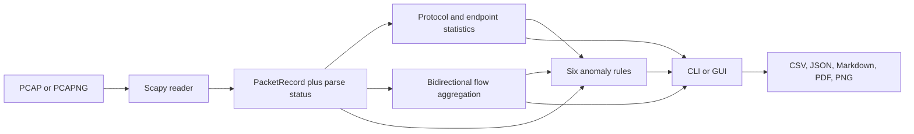

# Architecture

## Scope

PacketStats is a Python 3.10+ application with a Scapy analysis core, a Tkinter/ttk desktop interface, a CLI, and local export utilities. Offline parsing and live capture share packet, flow, statistics, and detection models. Live capture is passive: PacketStats does not transmit or inject packets.

## Package map

| Module | Responsibility |
| --- | --- |
| `models.py` | Packet, flow, alert, and analysis summary dataclasses. |
| `parser.py` | Validate and read PCAP/PCAPNG via Scapy; normalize primary protocol and decoded header metadata. |
| `flows.py` | Canonical bidirectional flow keys and directional packet/byte accounting. |
| `statistics.py` | Protocol, endpoint, packet-size, and time-bucket metrics. |
| `config.py` | Detector and processing configuration with validation and JSON load/save. |
| `detectors.py` | Six explainable threshold/statistics-based anomaly detectors. |
| `live.py` | Interface discovery, Scapy capture lifecycle, bounded recent history, and optional PCAPNG recording. |
| `reporting.py` | CSV, JSON, Markdown, and PDF report output. |
| `visualisation.py` | Matplotlib charts and PNG export. |
| `cli.py` | CLI commands and the shared offline analysis pipeline. |
| `gui.py` | Tkinter desktop application; analysis and report work run in worker threads. |

## Offline pipeline

`stream_packets()` yields records incrementally. The current full offline analysis pipeline collects records in memory because statistics, detector evaluation, and the GUI Packet Explorer use the capture-wide packet collection. The Packet Explorer limits visible rows to 500 per page; this does not bound total analysis memory for large files.

## Packet lifecycle and accounting

The parser yields one normalized `PacketRecord` for each frame Scapy returns. A record has a primary protocol label and `OK`, `PARTIAL`, or `ERROR` parse status. Parser errors yielded as records use `CORRUPTED`. See [data_model.md](data_model.md) for exact counter definitions and byte accounting.

Flow aggregation requires source and destination IP addresses. Link-layer-only, failed, and otherwise endpoint-incomplete records remain part of capture and protocol statistics but cannot be assigned to an IP flow. A packet contributes once to each endpoint's participation counters, while source-share calculations attribute it once to its source.

## Flow key and direction

`FlowKey.build()` canonicalizes the two `(address, port)` endpoints lexicographically and includes the primary protocol. Reversing source and destination therefore gives the same key. Directional counters attribute a packet to A→B when its source matches endpoint A; otherwise it contributes to B→A. Flow timestamps track minimum and maximum observed timestamps, including out-of-order input.

## GUI threading

Tk widgets are accessed on the Tk main thread. Offline analysis runs in a worker thread and sends completion/error messages through a thread-safe queue; the main loop polls the queue and updates the widgets. Live capture uses Scapy's asynchronous capture lifecycle and forwards bounded UI events. Capture history and event queues are bounded; offline analysis still buffers its packet records.

## Protocol and privacy boundaries

The parser exposes metadata Scapy decodes (including common IPv4/IPv6, transport, DNS, ARP, ICMP, and IGMP fields). This is not a complete protocol dissector. TLS/HTTPS application contents are not decrypted. Packet records do not retain raw payload bytes; the GUI packet detail pane shows decoded header fields, not a raw hex dump.

## Performance notes

- Parsing is O(N) in packet count; streaming iteration itself is incremental.
- The shared offline pipeline retains O(N) packet records and computes flow state in O(F), where F is distinct flows.
- GUI table rendering is paginated, but filtering scans the in-memory packet list.
- Live history, flows, and event delivery use configured bounds.

## Extension points

New analyses should consume `PacketRecord` and return typed results in a separate module. Keep packet capture, parsing, analysis, presentation, and export code separated. Document evidence and limits for any new heuristic; do not describe indicators as proof of an attack.
